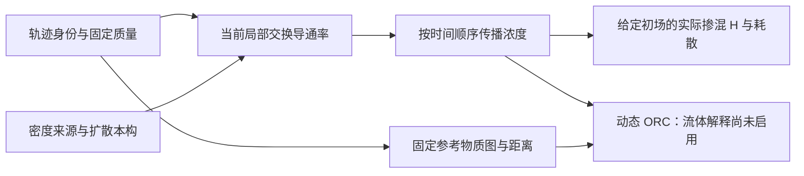

# LTN 扩散与掺混：理论主线、实现与验证总览

整理日期：2026-11-07。依据本地恢复点 `f4a6822` 及其保存结果。本文是当前阅读入口；原规范和历史结果保持原样。

**项目承接了原理论的质量测度、局部交换和时序传播主线，已经完成图层实现及多组限定流动的验证；“由轨迹可靠预测一般流体掺混，再解释动态 ORC”的完整方法仍未验收。Stage3 为 incomplete，fluid ORC 关闭。按用户要求暂停新增研究，本次只整理文档。**

## 1. 最初要解决什么，现在走到哪里

原目标是：从带有固定身份的流体轨迹、初始质量和扩散本构出发，描述哪些物质发生交换、给定浓度场如何均匀化，再用动态曲率描述传播的收缩性质。位置靠近、界面拉长或网络结构变化，本身不等于分子混合。

当前最主要的科学问题仍在第二个框：**什么局部交换规则既保持质量、正性，又准确逼近目标扩散方程？** 后面的传播和统计不能弥补这里的物理误差。

前期先用真实物质面建立普通有限体积基线，回答“质量平均未知量应该怎样交换”；随后转向从轨迹点、密度和边界构造交换面的候选，回答“如何接回 LTN 的输入”。最近的 kernel/ledger 研究检查的是上图中“密度来源”这个输入环节。它有必要，但不能代替整条理论主线。

此前按轮次不断拆分诊断、契约和审计，使局部问题占据了交接首页。这次改为按理论环节阅读；126 条历史记录只作追溯，不作为理解项目的先决条件。

## 2. 与最初理论各部分的关系

这里以原始 [METHOD.md](METHOD.md) 的最终约定为主，结合 [CODE_REVIEW.md](CODE_REVIEW.md) 对旧 LHD/原型代码的审查。早期报告中的其他理论分支仍保留，不把它们都算成本阶段已经实现的内容。

| 原有思想或成果 | 在当前工作的具体位置 | 当前能够支持的说法 |
|---|---|---|
| 拉格朗日轨迹网络 LTN | 固定物质身份；参考邻接与当前交换邻接分开 | 延续原主线；轨迹还需质量、密度来源、D 和边界信息才能确定扩散问题 |
| LHD 中的质量测度与密度账本 | 固定质量矩阵 M；oracle、核重构、固定邻居环 ledger 分别作为密度来源 | 继承质量测度思想；当前无 F 拟合的环代理不等于旧 ledger_v4，也不代表完整 LHD 已移植 |
| 界面拉伸、压缩与掺混 | 解释流动如何改变物质接近、方向和扩散距离 | 在光滑、薄层等适用条件下作为解释与对照；拉伸率不直接充当全局混合率 |
| 网络扩散 | 对称非负导通率、固定质量生成元、时间有序传播 | 图层性质明确；流体连续一致性必须另验 |
| AFRC 与动态 ORC | AFRC 保留结构识别定位；ORC 对传播核及参考距离定义收缩 | 两者不等价；目前没有流体 ORC 的新计算结论 |
| Hodge/Dirac、压力、黏性功、声学等 | 原始资料和理论背景 | 按原 METHOD 第 10 节不进入本篇扩散掺混主线；本阶段不宣称验证这些分支 |

当前工作是在验证原理论中“运动学信息怎样变成可信物理交换”的关键环节。它尚未完成原理论的全部应用，也没有以有限体积本身取代 LTN 目标。

## 3. 需要固定下来的数学对象

### 物质状态与密度语义

物质单元随流运动，质量固定，状态为质量平均：

\[
m_i=\int_{K_i(t)}\rho\,dV,\qquad
\bar c_i=\frac{1}{m_i}\int_{K_i(t)}\rho c\,dV.
\]

轨迹点浓度、点密度 \(\rho(X_i,t)\)、物质单元平均密度 \(m_i/|K_i(t)|\) 是不同对象。辅助 Voronoi 面可用于构造候选交换，但其区域不是自动随流运动的真实物质单元；也不能据此把质量改为“点密度 × 当前 Voronoi 面积”。在核求积中，\(m_i/\rho(X_i,t)\) 只是相应求积权重，不天然等于真实物质体积。

### 两套基础图与派生传播核

- 参考物质图 \(G_{ref}\)：固定标签和参考边长，形成 ORC 使用的距离 \(d_0\)。
- 当前交换图 \(G_{ex}(t)\)：同一批标签，当前局部邻接和导通率 \(g_{ij}(t)\)。
- 传播核 \(P(t_1,t_0)\)：由交换演化得到，不是额外任意指定的一套基础图。

令 \(M=\operatorname{diag}(m_i)\)、\(L=B^T\operatorname{diag}(g)B\)，图层方程为

\[
M\dot{\bar c}+L(t)\bar c=0,\qquad Q=-M^{-1}L.
\]

固定正质量、对称非负导通率和封闭边界给出质量守恒、常数保持、最大值原理和方差耗散。这些是有条件的离散代数性质。还需证明或数值验证该离散逼近 \(\rho D_t c=\nabla\cdot(\rho D\nabla c)\)，才可以作相应流体解释。\(\Gamma=\rho D\)，恒 D 与恒 Γ 是不同本构，不能混为同一个精度比较。

传播必须保持时间顺序。原规范默认隐式 Euler：\(A_n=(M+\Delta t_n L_n)^{-1}M\)，\(P=A_{K-1}\cdots A_0\)。一般不能用平均生成元的一次指数替代这个过程。当前部分研究用冻结中点指数作用，并以独立 uniformization 递推核验；其验证不能直接算作默认隐式 Euler 生产接口已完成迁移。

### 实际掺混与曲率分别回答什么

设 \(c_m=\sum_i m_i\bar c_i/\sum_i m_i\)，

\[
E=\tfrac12\sum_i m_i(\bar c_i-c_m)^2,\quad
\chi=\sum_{i<j}g_{ij}(\bar c_i-\bar c_j)^2,\quad
\dot E=-\chi,\quad H=1-E(t)/E(0).
\]

\(H\) 描述给定初场的质量方差减少，\(E(0)=0\) 单独处理。时间离散造成的附加耗散须与上述半离散交换耗散分开。当前 `voronoi_time_action.metrics` 的 `variance` 字段保存 \(\sum m_i(\bar c_i-c_m)^2=2E\)，其比值 H 与这里一致；读取绝对耗散量时须保留这个因子约定。

动态 ORC 的约定为

\[
\kappa_{ij}=1-\frac{W_{1,d_0}(P_{i,:},P_{j,:})}{d_0(i,j)}.
\]

该定义只用于 \(0<d_0(i,j)<\infty\) 的探针对。它描述指定度量与时间窗下的最坏 Lipschitz 对比收缩，不能代替某个实际初场的 \(H\)。\(D=0\) 应给出恒等传播和无扩散掺混；压缩且 \(D>0\) 则可能增强扩散。当前 \(\kappa\) 未计算，fluid ORC 继续关闭。

## 4. 理论对象对应哪些代码

当前可读取的新增实现主要位于 `research/`。原 [CODEX_TASK.md](CODEX_TASK.md) 所列 `src/ltnmix/`、CLI 和打包接口是设计任务，不能用那份清单声称当前已有完整产品。旧 v0.8.0、246 项测试及其目标 NPZ 尚未恢复。

| 环节 | 实际代码入口 | 用途及边界 |
|---|---|---|
| 固定身份、质量、两图及小图传播 | [trajectory_chain.py](../research/reconnect/trajectory_chain.py) | `TrajectorySamples`、`laplacian`、`reference_distances`、`propagate_supplied`；调用方提供电导，不能自动保证流体一致性 |
| 真实物质面普通中心阻力基线 | [material_fv.py](../research/material_fv/material_fv.py) | 一维真实移动面；几何中点间积分阻力、固定质量、隐式 Euler |
| Becker 重建与三种通量对照 | [experiment.py](../research/rebuild/experiment.py)、[reference.py](../research/rebuild/reference.py) | 几何中点、质量中点、质量平均阻力明确分列；独立细网格参考及物质平均投影 |
| 轨迹点生成候选交换面 | [periodic_voronoi_fv.py](../research/reconnect/periodic_voronoi_fv.py)、[bounded_periodic_voronoi.py](../research/reconnect/bounded_periodic_voronoi.py) | 普通串联阻力候选；周期和有界几何各有适用条件，辅助面不被冒称为真实物质面 |
| 稀疏作用、独立递推与掺混量 | [voronoi_time_action.py](../research/reconnect/voronoi_time_action.py) | `operators`、`exponential`、`uniformization`、`metrics`、`dissipation`；研究级推进与核验 |
| 密度适配 | [t1_density_sources.py](../research/reconnect/t1_density_sources.py)、[compression_density_sources.py](../research/reconnect/compression_density_sources.py) | 固定质量核重构和固定邻居环代理；与 oracle 使用同一后端比较 |
| 平滑流及接触参考 | [compression_reference.py](../research/reconnect/compression_reference.py)、[contact_spectral_reference.py](../research/reconnect/contact_spectral_reference.py) | 独立参考与误差控制；不是用候选结果反拟合参考 |
| 动态 ORC | 原 METHOD 第 8 节；[主线回接报告](../research/reconnect/MAINLINE_RECONNECTION.md) | 保留定义与启用条件；当前重建链没有已验收的流体 ORC 实现成果 |

`reference_baseline/`、`prototypes/`、`legacy_sources/` 是保留的历史来源。代码中旧的裁剪、补质量和 F 拟合分支，不因被保留而成为当前允许的默认路径。

## 5. 哪些验证已经有了

下表是保存结果的归纳，未在此次整理中重跑。详细来源见 [联合证据报告](../research/reconnect/JOINT_EVIDENCE_REVIEW.md) 和 [逐条证据账本](../runs/reconnect-joint-evidence/evidence-ledger.json)。T0–T6 是实验编号，与实施阶段 Stage1–Stage4 不同，T3 通过不等于 Stage3 通过。

| 层级或算例 | 已有证据 | 仍需遵守的范围 |
|---|---|---|
| 离散图层 | 小图质量、正性、能量、传播方向和时间非对易检查；[主线回接](../research/reconnect/MAINLINE_RECONNECTION.md) | 给定图的正确性不证明电导代表真实流体 |
| 真物质面 Becker 基线 | 三种通量、时间/参考检查及 32/64/128 列空间细化；[空间报告](../research/rebuild/SPATIAL_CONVERGENCE.md) | 固定物理问题的观察阶接近二阶；不等于通用点轨迹后端验收 |
| T1 静止正弦 | oracle 三空间档与时间控制；[T1 报告](../research/reconnect/T1_UNIFORM_COMPARISON.md) | 限定均匀周期物质平均案例 |
| T2 客观性、零扩散 | [平移](../research/reconnect/T2_TRANSLATION_COMPARISON.md)、[D=0](../research/reconnect/T2_D0_COMPARISON.md)、[共转边界](../research/reconnect/T2_ROTATION_COMPARISON.md) 控制 | 限定输入和边界；没有运行曲率 |
| T3 平滑运动 | [仿射压缩](../research/reconnect/T3_AFFINE_SPATIAL_COMPARISON.md)、[仿射剪切](../research/reconnect/AFFINE_SHEAR_SPATIAL_COMPARISON.md) 三档及本构/方向控制；非线性周期压缩 oracle 空间证据 | 原 N32 未决记录保留；不能外推任意平滑流动或所有密度来源 |
| T4 独立接触 | [静态接触 oracle 三档](../research/reconnect/CONTACT_SPATIAL_COMPARISON.md) | 不代替移动激波和三来源比较 |
| T4 移动 Becker | δ=.08、共同 K32、32/64/128 列的八项空间改善分辨；[共同 K32 报告](../research/reconnect/BECKER_COMMON_K32_COMPARISON.md) | 固定八行的一维列细化；旧 K16 空间及后移 H 时间未决保持 |
| 层厚度变化 | [δ=.04 固定物质质量对照](../research/reconnect/BECKER_DELTA004_COMPARISON.md) 已执行 | 该例状态时间控制分辨，H 时间未分辨；只有 N32，两厚度不构成 δ→0 极限 |
| 同后端密度来源 | T1 N32、平滑运动 N64 的来源对照；[联合时间/参考控制](../research/reconnect/COMPRESSION_JOINT_CONTROL_RESULTS.md) | 已有单例，不等于瞬态三来源空间与接触/激波覆盖完成 |

### 最初 FV 判别实验的真实结果

旧独立原型所报 `4.2237e-4`、`4.9382e-4` 和旧核结果 `1.7642e-3` 没有原 NPZ 可核对，不作为本仓库已复现的测量值。

独立重建的同一 Becker 参数 δ=.08、D=.02、T=.1、32 个物质列，512 步结果为：

| 当前重建定义 | 相对初始质量波动范数的浓度误差 |
|---|---:|
| 普通阻力，真实单元几何中点 | 5.69194e-4 |
| 普通阻力，质量区间中点映射到空间 | 4.36001e-4 |
| 质量平均阻力通量 | 5.12753e-4 |

来源：[重建报告](../research/rebuild/REPORT.md)。中心约定会改变排序；常通量精确不能保证瞬态最优。普通几何中点保持原定基线，其余作为对照，不能按误差最小者悄悄更名。上述数据不能证明相对丢失旧核结果的改善倍数。

### 最近的密度研究到底说明什么

在同一平滑压缩的一个保存时刻，固定 `h=2/N`，N=64/128/256：kernel 点密度相对质量 L² 误差约 `6.17e-4 → 6.38e-4 → 6.44e-4`；固定环 ledger 约 `2.85e-4 → 7.14e-5 → 1.78e-5`。这是[单快照密度对照](../research/reconnect/DENSITY_SNAPSHOT_COMPARISON.md)，没有在这些新密度场上运行新的标量传播。

随后[误差结构复核](../research/reconnect/DENSITY_ERROR_STRUCTURE.md)和[一致性推导](../research/reconnect/DENSITY_KERNEL_CONSISTENCY.md)解释了固定核宽/粒子间距比例下的求积问题；结论受既定映射、采样和光滑性限制。ledger 的局部结果不能外推激波，kernel 的这一失败也不等于所有核方法失败。

此前出现的“近似密度让浓度误差更小”，包含与交换离散残差的抵消，不能说它比给定密度真值更准确。该分支在总报告中只承担密度输入诊断，不升级为项目新目标。

## 6. Stage3 还差什么，哪些并非新的通过条件

原验收依据是 METHOD 第 11–13 节和 CODEX_TASK 第三阶段。本次不改变它们、不增设阈值，也不把完成度换算成百分比。

| 尚未闭合的问题 | 与原要求的关系 | 目前的边界 |
|---|---|---|
| 同后端三密度来源的完整物理比较 | CODEX_TASK 第三阶段、METHOD 密度误差拆分 | 平滑单例和单时刻密度空间证据已经存在；仍缺相应瞬态空间、接触/激波覆盖，失败候选须保留失败及适用限制 |
| 激波的空间、时间与层厚度影响分开 | CODEX_TASK 要求分别控制 h、Δt、δ | δ=.08 有有效空间证据；δ=.04 只有单档空间且 H 时间未分辨，不能宣布一般层厚度收敛 |
| 研究候选的物理适用范围 | METHOD 要求正交换后端完成 T1–T4 后再作流体解释 | 真物质面基线、辅助面候选、不同边界包装器须分别标明；不能拼接局部成功来宣称通用后端通过 |

还要区分以下三类问题：

- **已登记的诊断未决项**：如部分 Becker 后移 H 检查、N64 ledger/oracle 终时 H 改善低于不确定度。保留原判定；不能改阈值制造通过，也不能据此要求无限增加时间档。
- **不是原验收要求的“胜负”**：ledger 必须胜过 oracle、每种新通量必须优于普通 FV，都不是 Stage3 完成条件。准确性、收敛与适用范围才是要回答的问题。
- **后续应用或交付目标**：复杂二维非平面激波、DNS、T5/T6、完整 ORC 应用、生产 CLI/包迁移仍有工作，但不一概追加为当前解析 Stage3 的新前提。旧 v0.8.0 能否找回也不是新研究完成的物理条件。

当前累计 **508 项检查记录**，包含重建软件与研究检查；不是 508 个独立物理算例，不包含尚未恢复的旧 246 项，也不是本轮重新执行 508 项。检查数量不表示 Stage3 完成程度。

## 7. 整理后的阅读方式与后续边界

1. 理解项目：读本文。
2. 核对原定义：读 [METHOD.md](METHOD.md) 和 [CODEX_TASK.md](CODEX_TASK.md)。它们保持原始字节，不追写新状态。
3. 查某项证据：从第 5 节进入对应报告，再查 `runs/` 的结果、输入和哈希；具体时间、边界、中心与误差定义以该报告为准。
4. 查全过程：[RESEARCH_STATUS.md](RESEARCH_STATUS.md) 保留追加式历史索引；旧 PHASE 文档是有日期的快照。
5. 新聊天交接或恢复：从 [GITHUB_HANDOFF.md](../GITHUB_HANDOFF.md) 开始，按备份清单核验实际可恢复范围。

**当前执行状态是研究暂停、文档整理完成。** `runs/reconnect-density-error-structure/next-gate-spec.json` 中固定旧带宽求积对照仅保留为历史建议，不再是自动执行的下一步。它及旧报告中的“下一步”均不能覆盖用户现在暂停研究的要求。

恢复研究时，应先明确要检验的具体主张及最小判别证据，再落实单个问题；每次进展说明都回到“原理论哪一环、得到什么证据、还不能说明什么”。不以增加报告、审计次数或反复加密代替物理结论。总览初次整理未运行新算例、未修改数值代码或旧结果。后续经用户要求制作完整 PDF、整理代码并更新 GitHub，见 [代码指南](CODE_GUIDE.md)、[下一步计划](NEXT_STEPS.md) 和当前交接入口；新物理实验仍未执行。
