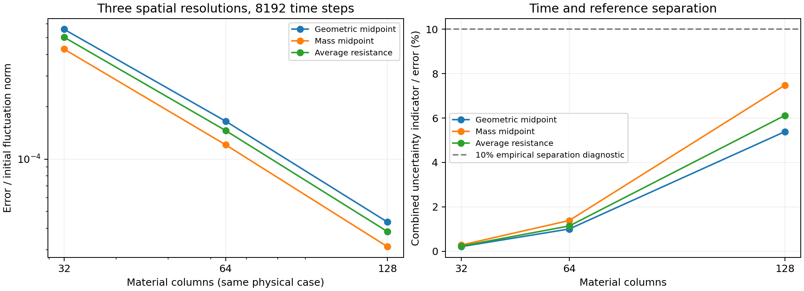
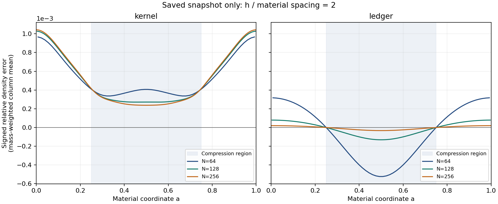

# 理论与数值证据附录

本附录重述已有规范及重建推导，不提出新的模型假设，不重算保存数据。

## 从连续方程到物质平均交换

连续性和被动质量分数方程为

\[
\partial_t\rho+\nabla\cdot(\rho u)=0,\qquad
\partial_t(\rho c)+\nabla\cdot(\rho u c)=\nabla\cdot(\rho D\nabla c).
\]

对随流运动的物质区域应用输运定理，对流通量被物质边界运动抵消：

\[
\dot m_i=0,\qquad
m_i\dot{\bar c}_i=\int_{\partial K_i(t)}\rho D\nabla c\cdot n_i\,dS.
\]

相邻区域的公共面法向相反，共享一个通量即可实现组分质量的成对抵消。但“共享且守恒”没有确定通量近似是否准确；这正是交换后端需要独立验证的原因。

在单位横截面的一维基准中，以物质质量坐标 μ 表示，\(dx/d\mu=1/\rho\)，则

\[
\left.\partial_t c\right|_\mu=\partial_\mu(\rho^2D\partial_\mu c),\qquad
J=-\rho^2D\partial_\mu c.
\]

普通中心阻力取

\[
g_{i,i+1}=\left[\int_{x_i^*}^{x_{i+1}^*}\frac{dx}{\rho D}\right]^{-1},\qquad
J_{i+1/2}\approx g_{i,i+1}(\bar c_i-\bar c_{i+1}).
\]

代表位置 \(x_i^*\) 的几何中点与质量中点定义不同；不能在比较后悄悄切换。实验性的质量平均阻力使用 \(\partial_\mu\psi=1/(\rho^2D)\)、\(\bar\psi_i=m_i^{-1}\int_i\psi\,d\mu\)，并取 \(g=(\bar\psi_{i+1}-\bar\psi_i)^{-1}\)。它精确表达局部恒通量态的平均差，仍不保证瞬态优于普通阻力。D=0 使用零交换分支，不直接代入上述逆阻力表达。

## 图层恒等式与时间离散

设 \(L=B^T\operatorname{diag}(g)B\)。无向共享边使 \(L\mathbf1=0\)、\(L=L^T\)，从而

\[
\frac{d}{dt}\sum_i m_i\bar c_i=0,\qquad
\frac{d}{dt}\frac12\|\bar c-c_m\mathbf1\|_M^2
=-\bar c^TL\bar c=-\sum_{i<j}g_{ij}(\bar c_i-\bar c_j)^2.
\]

非负 g 还使 Q 的非对角元非负。该正性约束与准确逼近连续算子是两个条件；P1 能量半正定不自动给出 Markov 符号，事后裁剪也会改变原算子。

隐式 Euler 满足

\[
E_{n+1}-E_n=-\Delta t\,\bar c_{n+1}^TL_n\bar c_{n+1}
-\tfrac12\|\bar c_{n+1}-\bar c_n\|_M^2.
\]

最后一项是时间离散附加耗散。相应的浓度传播 P 为行随机核，而组分质量列向量 \(a=M\bar c\) 的映射是 \(MPM^{-1}\)；二者不能混淆。各步可逆也不意味着整段有序传播满足详细平衡。

## 误差定义与可分辨性

浓度比较使用原初始波动归一化：

\[
\epsilon_c=\frac{\sqrt{\sum_i m_i(\bar c_i-\bar c_{ref,i})^2}}
{\sqrt{\sum_i m_i(\bar c_{0,i}-c_{m,0})^2}}.
\]

跨分辨率研究还需明确采用各档原生初始分母，还是共同物质观测的固定分母。两类报告都存在，必须按各案例原定义读取，不能把不同分母下的数字直接相除。参考终态接近常量时，不能改用其标准差放大误差。

误差改善应与双方时间差、独立参考空间/时间差、投影桥和实现余量比较。已有预算多为可计算的经验指标或特定数值核验界，不一概称为连续 PDE 的严格总误差上界。原 1e-10 代数守卫不是统一物理精度门槛。

## 保存结果选表：同一时间分辨率的 Becker 空间比较

δ=.08、D=.02、T=.1，固定八行、K32；浓度分母为原 32 列初始质量波动 σ32。下表来自 `runs/reconnect-becker-common-k32/results.json` 及对应报告，数值只为排版取舍有效位。

| 物质列数 | 原生浓度误差/σ32 | 共同观测浓度误差/σ32 | 原生 H 参考误差 |
|---:|---:|---:|---:|
| 32 | 4.063645212e-4 | 4.063645212e-4 | 4.10694194e-5 |
| 64 | 1.185903166e-4 | 1.102586130e-4 | 1.041971824e-5 |
| 128 | 3.269596647e-5 | 2.975431612e-5 | 2.630312728e-6 |

八项相邻空间改善超过该次固定指标。这支持固定物理层、固定横向行数的列细化；不意味着二维联合收敛或旧 K16/后移 H 未决被取消。

## 保存结果选表：密度来源与误差抵消

平滑压缩 N64、K64、D=.02、T=.05；与独立 n2048/k2048 参考比较。来源为 `runs/reconnect-compression-joint-control/results.json`。

| 时刻 | oracle 浓度误差 | ledger 浓度误差 | H 误差改善幅度 | 完整 H 预算 |
|---:|---:|---:|---:|---:|
| .025 | 3.457366655e-5 | 3.373684893e-5 | 4.786166449e-7 | 4.094863222e-7 |
| .05 | 6.369542768e-5 | 6.221697904e-5 | 3.324187166e-7 | 7.699403564e-7 |

终时 H 改善没有超过预算。令 \(e_o=u_o-R\)、\(d=u_l-u_o\)，则

\[
\|u_l-R\|_M^2-\|u_o-R\|_M^2=2\langle e_o,d\rangle_M+\|d\|_M^2.
\]

负交叉项可能使有偏密度对应的浓度误差反而更小；保存场已观察到这种抵消。因此这类排名不是密度比 oracle 更准确的证据，也不是要求 ledger 必须胜过 oracle 的理由。

## 图表与来源

下图沿用原结果，不重算或拟合。第一图属于真实物质面 FV 基线；第二图属于单快照密度输入诊断，两者不能混作同一个后端的完整验收。

{width=90%}

{width=95%}

## 来源和可追溯边界

原始规范：`docs/METHOD.md`、`docs/CODEX_TASK.md`、`docs/CODE_REVIEW.md`。主线回接、空间控制、同后端来源比较、联合证据及密度结构报告均由项目总览链接到原文件。原始交接的 782 个文件按独立清单校验；15 个附件保存在原工作区，本次下载包不包含它们。

旧 v080 未恢复，旧 246 项测试与早期原型数字没有被重新认证。当前 508 项是累计重建检查记录；本次代码交付只重跑 15 项既有小型检查，不增加科学完成度。Stage3 incomplete，fluid ORC 关闭。
