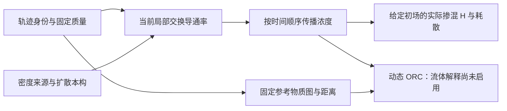

本报告整理现有研究，不新增物理实验。Stage3 尚未通过，fluid ORC 关闭。
旧 v0.8.0 未恢复；当前软件检查、限定算例结果和一般物理主张分别说明。
用户已要求更新 GitHub；远端是否完成以交接回执为准。

\newpage

# LTN 扩散与掺混：理论主线、实现与验证总览

整理日期：2026-11-07。依据本地恢复点 `f4a6822` 及其保存结果。本文是当前阅读入口；原规范和历史结果保持原样。

**项目承接了原理论的质量测度、局部交换和时序传播主线，已经完成图层实现及多组限定流动的验证；“由轨迹可靠预测一般流体掺混，再解释动态 ORC”的完整方法仍未验收。Stage3 为 incomplete，fluid ORC 关闭。按用户要求暂停新增研究，本次只整理文档。**

## 1. 最初要解决什么，现在走到哪里

原目标是：从带有固定身份的流体轨迹、初始质量和扩散本构出发，描述哪些物质发生交换、给定浓度场如何均匀化，再用动态曲率描述传播的收缩性质。位置靠近、界面拉长或网络结构变化，本身不等于分子混合。



当前最主要的科学问题仍在第二个框：**什么局部交换规则既保持质量、正性，又准确逼近目标扩散方程？** 后面的传播和统计不能弥补这里的物理误差。

前期先用真实物质面建立普通有限体积基线，回答“质量平均未知量应该怎样交换”；随后转向从轨迹点、密度和边界构造交换面的候选，回答“如何接回 LTN 的输入”。最近的 kernel/ledger 研究检查的是上图中“密度来源”这个输入环节。它有必要，但不能代替整条理论主线。

此前按轮次不断拆分诊断、契约和审计，使局部问题占据了交接首页。这次改为按理论环节阅读；126 条历史记录只作追溯，不作为理解项目的先决条件。

## 2. 与最初理论各部分的关系

这里以原始 [METHOD.md](https://github.com/hongjianli97/diffuse-mixing/blob/main/docs/METHOD.md) 的最终约定为主，结合 [CODE_REVIEW.md](https://github.com/hongjianli97/diffuse-mixing/blob/main/docs/CODE_REVIEW.md) 对旧 LHD/原型代码的审查。早期报告中的其他理论分支仍保留，不把它们都算成本阶段已经实现的内容。

| 原有思想或成果 | 在当前工作的具体位置 | 当前能够支持的说法 |
|---|---|---|
| 拉格朗日轨迹网络 LTN | 固定物质身份；参考邻接与当前交换邻接分开 | 延续原主线；轨迹还需质量、密度来源、D 和边界信息才能确定扩散问题 |
| LHD 中的质量测度与密度账本 | 固定质量矩阵 M；oracle、核重构、固定邻居环 ledger 分别作为密度来源 | 继承质量测度思想；当前无 F 拟合的环代理不等于旧 ledger_v4，也不代表完整 LHD 已移植 |
| 界面拉伸、压缩与掺混 | 解释流动如何改变物质接近、方向和扩散距离 | 在光滑、薄层等适用条件下作为解释与对照；拉伸率不直接充当全局混合率 |
| 网络扩散 | 对称非负导通率、固定质量生成元、时间有序传播 | 图层性质明确；流体连续一致性必须另验 |
| AFRC 与动态 ORC | AFRC 保留结构识别定位；ORC 对传播核及参考距离定义收缩 | 两者不等价；目前没有流体 ORC 的新计算结论 |
| Hodge/Dirac、压力、黏性功、声学等 | 原始资料和理论背景 | 按原 METHOD 第 10 节不进入本篇扩散掺混主线；本阶段不宣称验证这些分支 |

当前工作是在验证原理论中“运动学信息怎样变成可信物理交换”的关键环节。它尚未完成原理论的全部应用，也没有以有限体积本身取代 LTN 目标。

## 3. 需要固定下来的数学对象

### 物质状态与密度语义

物质单元随流运动，质量固定，状态为质量平均：

\[
m_i=\int_{K_i(t)}\rho\,dV,\qquad
\bar c_i=\frac{1}{m_i}\int_{K_i(t)}\rho c\,dV.
\]

轨迹点浓度、点密度 \(\rho(X_i,t)\)、物质单元平均密度 \(m_i/|K_i(t)|\) 是不同对象。辅助 Voronoi 面可用于构造候选交换，但其区域不是自动随流运动的真实物质单元；也不能据此把质量改为“点密度 × 当前 Voronoi 面积”。在核求积中，\(m_i/\rho(X_i,t)\) 只是相应求积权重，不天然等于真实物质体积。

### 两套基础图与派生传播核

- 参考物质图 \(G_{ref}\)：固定标签和参考边长，形成 ORC 使用的距离 \(d_0\)。
- 当前交换图 \(G_{ex}(t)\)：同一批标签，当前局部邻接和导通率 \(g_{ij}(t)\)。
- 传播核 \(P(t_1,t_0)\)：由交换演化得到，不是额外任意指定的一套基础图。

令 \(M=\operatorname{diag}(m_i)\)、\(L=B^T\operatorname{diag}(g)B\)，图层方程为

\[
M\dot{\bar c}+L(t)\bar c=0,\qquad Q=-M^{-1}L.
\]

固定正质量、对称非负导通率和封闭边界给出质量守恒、常数保持、最大值原理和方差耗散。这些是有条件的离散代数性质。还需证明或数值验证该离散逼近 \(\rho D_t c=\nabla\cdot(\rho D\nabla c)\)，才可以作相应流体解释。\(\Gamma=\rho D\)，恒 D 与恒 Γ 是不同本构，不能混为同一个精度比较。

传播必须保持时间顺序。原规范默认隐式 Euler：\(A_n=(M+\Delta t_n L_n)^{-1}M\)，\(P=A_{K-1}\cdots A_0\)。一般不能用平均生成元的一次指数替代这个过程。当前部分研究用冻结中点指数作用，并以独立 uniformization 递推核验；其验证不能直接算作默认隐式 Euler 生产接口已完成迁移。

### 实际掺混与曲率分别回答什么

设 \(c_m=\sum_i m_i\bar c_i/\sum_i m_i\)，

\[
E=\tfrac12\sum_i m_i(\bar c_i-c_m)^2,\quad
\chi=\sum_{i<j}g_{ij}(\bar c_i-\bar c_j)^2,\quad
\dot E=-\chi,\quad H=1-E(t)/E(0).
\]

\(H\) 描述给定初场的质量方差减少，\(E(0)=0\) 单独处理。时间离散造成的附加耗散须与上述半离散交换耗散分开。当前 `voronoi_time_action.metrics` 的 `variance` 字段保存 \(\sum m_i(\bar c_i-c_m)^2=2E\)，其比值 H 与这里一致；读取绝对耗散量时须保留这个因子约定。

动态 ORC 的约定为

\[
\kappa_{ij}=1-\frac{W_{1,d_0}(P_{i,:},P_{j,:})}{d_0(i,j)}.
\]

该定义只用于 \(0<d_0(i,j)<\infty\) 的探针对。它描述指定度量与时间窗下的最坏 Lipschitz 对比收缩，不能代替某个实际初场的 \(H\)。\(D=0\) 应给出恒等传播和无扩散掺混；压缩且 \(D>0\) 则可能增强扩散。当前 \(\kappa\) 未计算，fluid ORC 继续关闭。

## 4. 理论对象对应哪些代码

当前可读取的新增实现主要位于 `research/`。原 [CODEX_TASK.md](https://github.com/hongjianli97/diffuse-mixing/blob/main/docs/CODEX_TASK.md) 所列 `src/ltnmix/`、CLI 和打包接口是设计任务，不能用那份清单声称当前已有完整产品。旧 v0.8.0、246 项测试及其目标 NPZ 尚未恢复。

| 环节 | 实际代码入口 | 用途及边界 |
|---|---|---|
| 固定身份、质量、两图及小图传播 | [trajectory_chain.py](https://github.com/hongjianli97/diffuse-mixing/blob/main/research/reconnect/trajectory_chain.py) | `TrajectorySamples`、`laplacian`、`reference_distances`、`propagate_supplied`；调用方提供电导，不能自动保证流体一致性 |
| 真实物质面普通中心阻力基线 | [material_fv.py](https://github.com/hongjianli97/diffuse-mixing/blob/main/research/material_fv/material_fv.py) | 一维真实移动面；几何中点间积分阻力、固定质量、隐式 Euler |
| Becker 重建与三种通量对照 | [experiment.py](https://github.com/hongjianli97/diffuse-mixing/blob/main/research/rebuild/experiment.py)、[reference.py](https://github.com/hongjianli97/diffuse-mixing/blob/main/research/rebuild/reference.py) | 几何中点、质量中点、质量平均阻力明确分列；独立细网格参考及物质平均投影 |
| 轨迹点生成候选交换面 | [periodic_voronoi_fv.py](https://github.com/hongjianli97/diffuse-mixing/blob/main/research/reconnect/periodic_voronoi_fv.py)、[bounded_periodic_voronoi.py](https://github.com/hongjianli97/diffuse-mixing/blob/main/research/reconnect/bounded_periodic_voronoi.py) | 普通串联阻力候选；周期和有界几何各有适用条件，辅助面不被冒称为真实物质面 |
| 稀疏作用、独立递推与掺混量 | [voronoi_time_action.py](https://github.com/hongjianli97/diffuse-mixing/blob/main/research/reconnect/voronoi_time_action.py) | `operators`、`exponential`、`uniformization`、`metrics`、`dissipation`；研究级推进与核验 |
| 密度适配 | [t1_density_sources.py](https://github.com/hongjianli97/diffuse-mixing/blob/main/research/reconnect/t1_density_sources.py)、[compression_density_sources.py](https://github.com/hongjianli97/diffuse-mixing/blob/main/research/reconnect/compression_density_sources.py) | 固定质量核重构和固定邻居环代理；与 oracle 使用同一后端比较 |
| 平滑流及接触参考 | [compression_reference.py](https://github.com/hongjianli97/diffuse-mixing/blob/main/research/reconnect/compression_reference.py)、[contact_spectral_reference.py](https://github.com/hongjianli97/diffuse-mixing/blob/main/research/reconnect/contact_spectral_reference.py) | 独立参考与误差控制；不是用候选结果反拟合参考 |
| 动态 ORC | 原 METHOD 第 8 节；[主线回接报告](https://github.com/hongjianli97/diffuse-mixing/blob/main/research/reconnect/MAINLINE_RECONNECTION.md) | 保留定义与启用条件；当前重建链没有已验收的流体 ORC 实现成果 |

`reference_baseline/`、`prototypes/`、`legacy_sources/` 是保留的历史来源。代码中旧的裁剪、补质量和 F 拟合分支，不因被保留而成为当前允许的默认路径。

## 5. 哪些验证已经有了

下表是保存结果的归纳，未在此次整理中重跑。详细来源见 [联合证据报告](https://github.com/hongjianli97/diffuse-mixing/blob/main/research/reconnect/JOINT_EVIDENCE_REVIEW.md) 和 [逐条证据账本](https://github.com/hongjianli97/diffuse-mixing/blob/main/runs/reconnect-joint-evidence/evidence-ledger.json)。T0–T6 是实验编号，与实施阶段 Stage1–Stage4 不同，T3 通过不等于 Stage3 通过。

| 层级或算例 | 已有证据 | 仍需遵守的范围 |
|---|---|---|
| 离散图层 | 小图质量、正性、能量、传播方向和时间非对易检查；[主线回接](https://github.com/hongjianli97/diffuse-mixing/blob/main/research/reconnect/MAINLINE_RECONNECTION.md) | 给定图的正确性不证明电导代表真实流体 |
| 真物质面 Becker 基线 | 三种通量、时间/参考检查及 32/64/128 列空间细化；[空间报告](https://github.com/hongjianli97/diffuse-mixing/blob/main/research/rebuild/SPATIAL_CONVERGENCE.md) | 固定物理问题的观察阶接近二阶；不等于通用点轨迹后端验收 |
| T1 静止正弦 | oracle 三空间档与时间控制；[T1 报告](https://github.com/hongjianli97/diffuse-mixing/blob/main/research/reconnect/T1_UNIFORM_COMPARISON.md) | 限定均匀周期物质平均案例 |
| T2 客观性、零扩散 | [平移](https://github.com/hongjianli97/diffuse-mixing/blob/main/research/reconnect/T2_TRANSLATION_COMPARISON.md)、[D=0](https://github.com/hongjianli97/diffuse-mixing/blob/main/research/reconnect/T2_D0_COMPARISON.md)、[共转边界](https://github.com/hongjianli97/diffuse-mixing/blob/main/research/reconnect/T2_ROTATION_COMPARISON.md) 控制 | 限定输入和边界；没有运行曲率 |
| T3 平滑运动 | [仿射压缩](https://github.com/hongjianli97/diffuse-mixing/blob/main/research/reconnect/T3_AFFINE_SPATIAL_COMPARISON.md)、[仿射剪切](https://github.com/hongjianli97/diffuse-mixing/blob/main/research/reconnect/AFFINE_SHEAR_SPATIAL_COMPARISON.md) 三档及本构/方向控制；非线性周期压缩 oracle 空间证据 | 原 N32 未决记录保留；不能外推任意平滑流动或所有密度来源 |
| T4 独立接触 | [静态接触 oracle 三档](https://github.com/hongjianli97/diffuse-mixing/blob/main/research/reconnect/CONTACT_SPATIAL_COMPARISON.md) | 不代替移动激波和三来源比较 |
| T4 移动 Becker | δ=.08、共同 K32、32/64/128 列的八项空间改善分辨；[共同 K32 报告](https://github.com/hongjianli97/diffuse-mixing/blob/main/research/reconnect/BECKER_COMMON_K32_COMPARISON.md) | 固定八行的一维列细化；旧 K16 空间及后移 H 时间未决保持 |
| 层厚度变化 | [δ=.04 固定物质质量对照](https://github.com/hongjianli97/diffuse-mixing/blob/main/research/reconnect/BECKER_DELTA004_COMPARISON.md) 已执行 | 该例状态时间控制分辨，H 时间未分辨；只有 N32，两厚度不构成 δ→0 极限 |
| 同后端密度来源 | T1 N32、平滑运动 N64 的来源对照；[联合时间/参考控制](https://github.com/hongjianli97/diffuse-mixing/blob/main/research/reconnect/COMPRESSION_JOINT_CONTROL_RESULTS.md) | 已有单例，不等于瞬态三来源空间与接触/激波覆盖完成 |

### 最初 FV 判别实验的真实结果

旧独立原型所报 `4.2237e-4`、`4.9382e-4` 和旧核结果 `1.7642e-3` 没有原 NPZ 可核对，不作为本仓库已复现的测量值。

独立重建的同一 Becker 参数 δ=.08、D=.02、T=.1、32 个物质列，512 步结果为：

| 当前重建定义 | 相对初始质量波动范数的浓度误差 |
|---|---:|
| 普通阻力，真实单元几何中点 | 5.69194e-4 |
| 普通阻力，质量区间中点映射到空间 | 4.36001e-4 |
| 质量平均阻力通量 | 5.12753e-4 |

来源：[重建报告](https://github.com/hongjianli97/diffuse-mixing/blob/main/research/rebuild/REPORT.md)。中心约定会改变排序；常通量精确不能保证瞬态最优。普通几何中点保持原定基线，其余作为对照，不能按误差最小者悄悄更名。上述数据不能证明相对丢失旧核结果的改善倍数。

### 最近的密度研究到底说明什么

在同一平滑压缩的一个保存时刻，固定 `h=2/N`，N=64/128/256：kernel 点密度相对质量 L² 误差约 `6.17e-4 → 6.38e-4 → 6.44e-4`；固定环 ledger 约 `2.85e-4 → 7.14e-5 → 1.78e-5`。这是[单快照密度对照](https://github.com/hongjianli97/diffuse-mixing/blob/main/research/reconnect/DENSITY_SNAPSHOT_COMPARISON.md)，没有在这些新密度场上运行新的标量传播。

随后[误差结构复核](https://github.com/hongjianli97/diffuse-mixing/blob/main/research/reconnect/DENSITY_ERROR_STRUCTURE.md)和[一致性推导](https://github.com/hongjianli97/diffuse-mixing/blob/main/research/reconnect/DENSITY_KERNEL_CONSISTENCY.md)解释了固定核宽/粒子间距比例下的求积问题；结论受既定映射、采样和光滑性限制。ledger 的局部结果不能外推激波，kernel 的这一失败也不等于所有核方法失败。

此前出现的“近似密度让浓度误差更小”，包含与交换离散残差的抵消，不能说它比给定密度真值更准确。该分支在总报告中只承担密度输入诊断，不升级为项目新目标。

## 6. Stage3 还差什么，哪些并非新的通过条件

原验收依据是 METHOD 第 11–13 节和 CODEX_TASK 第三阶段。本次不改变它们、不增设阈值，也不把完成度换算成百分比。

| 尚未闭合的问题 | 与原要求的关系 | 目前的边界 |
|---|---|---|
| 同后端三密度来源的完整物理比较 | CODEX_TASK 第三阶段、METHOD 密度误差拆分 | 平滑单例和单时刻密度空间证据已经存在；仍缺相应瞬态空间、接触/激波覆盖，失败候选须保留失败及适用限制 |
| 激波的空间、时间与层厚度影响分开 | CODEX_TASK 要求分别控制 h、Δt、δ | δ=.08 有有效空间证据；δ=.04 只有单档空间且 H 时间未分辨，不能宣布一般层厚度收敛 |
| 研究候选的物理适用范围 | METHOD 要求正交换后端完成 T1–T4 后再作流体解释 | 真物质面基线、辅助面候选、不同边界包装器须分别标明；不能拼接局部成功来宣称通用后端通过 |

还要区分以下三类问题：

- **已登记的诊断未决项**：如部分 Becker 后移 H 检查、N64 ledger/oracle 终时 H 改善低于不确定度。保留原判定；不能改阈值制造通过，也不能据此要求无限增加时间档。
- **不是原验收要求的“胜负”**：ledger 必须胜过 oracle、每种新通量必须优于普通 FV，都不是 Stage3 完成条件。准确性、收敛与适用范围才是要回答的问题。
- **后续应用或交付目标**：复杂二维非平面激波、DNS、T5/T6、完整 ORC 应用、生产 CLI/包迁移仍有工作，但不一概追加为当前解析 Stage3 的新前提。旧 v0.8.0 能否找回也不是新研究完成的物理条件。

当前累计 **508 项检查记录**，包含重建软件与研究检查；不是 508 个独立物理算例，不包含尚未恢复的旧 246 项，也不是本轮重新执行 508 项。检查数量不表示 Stage3 完成程度。

## 7. 整理后的阅读方式与后续边界

1. 理解项目：读本文。
2. 核对原定义：读 [METHOD.md](https://github.com/hongjianli97/diffuse-mixing/blob/main/docs/METHOD.md) 和 [CODEX_TASK.md](https://github.com/hongjianli97/diffuse-mixing/blob/main/docs/CODEX_TASK.md)。它们保持原始字节，不追写新状态。
3. 查某项证据：从第 5 节进入对应报告，再查 `runs/` 的结果、输入和哈希；具体时间、边界、中心与误差定义以该报告为准。
4. 查全过程：[RESEARCH_STATUS.md](https://github.com/hongjianli97/diffuse-mixing/blob/main/docs/RESEARCH_STATUS.md) 保留追加式历史索引；旧 PHASE 文档是有日期的快照。
5. 新聊天交接或恢复：从 [GITHUB_HANDOFF.md](https://github.com/hongjianli97/diffuse-mixing/blob/main/GITHUB_HANDOFF.md) 开始，按备份清单核验实际可恢复范围。

**当前执行状态是研究暂停、文档整理完成。** `runs/reconnect-density-error-structure/next-gate-spec.json` 中固定旧带宽求积对照仅保留为历史建议，不再是自动执行的下一步。它及旧报告中的“下一步”均不能覆盖用户现在暂停研究的要求。

恢复研究时，应先明确要检验的具体主张及最小判别证据，再落实单个问题；每次进展说明都回到“原理论哪一环、得到什么证据、还不能说明什么”。不以增加报告、审计次数或反复加密代替物理结论。总览初次整理未运行新算例、未修改数值代码或旧结果。后续经用户要求制作完整 PDF、整理代码并更新 GitHub，见 [代码指南](https://github.com/hongjianli97/diffuse-mixing/blob/main/docs/CODE_GUIDE.md)、[下一步计划](https://github.com/hongjianli97/diffuse-mixing/blob/main/docs/NEXT_STEPS.md) 和当前交接入口；新物理实验仍未执行。


\newpage

# 理论与数值证据附录

本附录重述已有规范及重建推导，不提出新的模型假设，不重算保存数据。

## 从连续方程到物质平均交换

连续性和被动质量分数方程为

\[
\partial_t\rho+\nabla\cdot(\rho u)=0,\qquad
\partial_t(\rho c)+\nabla\cdot(\rho u c)=\nabla\cdot(\rho D\nabla c).
\]

对随流运动的物质区域应用输运定理，对流通量被物质边界运动抵消：

\[
\dot m_i=0,\qquad
m_i\dot{\bar c}_i=\int_{\partial K_i(t)}\rho D\nabla c\cdot n_i\,dS.
\]

相邻区域的公共面法向相反，共享一个通量即可实现组分质量的成对抵消。但“共享且守恒”没有确定通量近似是否准确；这正是交换后端需要独立验证的原因。

在单位横截面的一维基准中，以物质质量坐标 μ 表示，\(dx/d\mu=1/\rho\)，则

\[
\left.\partial_t c\right|_\mu=\partial_\mu(\rho^2D\partial_\mu c),\qquad
J=-\rho^2D\partial_\mu c.
\]

普通中心阻力取

\[
g_{i,i+1}=\left[\int_{x_i^*}^{x_{i+1}^*}\frac{dx}{\rho D}\right]^{-1},\qquad
J_{i+1/2}\approx g_{i,i+1}(\bar c_i-\bar c_{i+1}).
\]

代表位置 \(x_i^*\) 的几何中点与质量中点定义不同；不能在比较后悄悄切换。实验性的质量平均阻力使用 \(\partial_\mu\psi=1/(\rho^2D)\)、\(\bar\psi_i=m_i^{-1}\int_i\psi\,d\mu\)，并取 \(g=(\bar\psi_{i+1}-\bar\psi_i)^{-1}\)。它精确表达局部恒通量态的平均差，仍不保证瞬态优于普通阻力。D=0 使用零交换分支，不直接代入上述逆阻力表达。

## 图层恒等式与时间离散

设 \(L=B^T\operatorname{diag}(g)B\)。无向共享边使 \(L\mathbf1=0\)、\(L=L^T\)，从而

\[
\frac{d}{dt}\sum_i m_i\bar c_i=0,\qquad
\frac{d}{dt}\frac12\|\bar c-c_m\mathbf1\|_M^2
=-\bar c^TL\bar c=-\sum_{i<j}g_{ij}(\bar c_i-\bar c_j)^2.
\]

非负 g 还使 Q 的非对角元非负。该正性约束与准确逼近连续算子是两个条件；P1 能量半正定不自动给出 Markov 符号，事后裁剪也会改变原算子。

隐式 Euler 满足

\[
E_{n+1}-E_n=-\Delta t\,\bar c_{n+1}^TL_n\bar c_{n+1}
-\tfrac12\|\bar c_{n+1}-\bar c_n\|_M^2.
\]

最后一项是时间离散附加耗散。相应的浓度传播 P 为行随机核，而组分质量列向量 \(a=M\bar c\) 的映射是 \(MPM^{-1}\)；二者不能混淆。各步可逆也不意味着整段有序传播满足详细平衡。

## 误差定义与可分辨性

浓度比较使用原初始波动归一化：

\[
\epsilon_c=\frac{\sqrt{\sum_i m_i(\bar c_i-\bar c_{ref,i})^2}}
{\sqrt{\sum_i m_i(\bar c_{0,i}-c_{m,0})^2}}.
\]

跨分辨率研究还需明确采用各档原生初始分母，还是共同物质观测的固定分母。两类报告都存在，必须按各案例原定义读取，不能把不同分母下的数字直接相除。参考终态接近常量时，不能改用其标准差放大误差。

误差改善应与双方时间差、独立参考空间/时间差、投影桥和实现余量比较。已有预算多为可计算的经验指标或特定数值核验界，不一概称为连续 PDE 的严格总误差上界。原 1e-10 代数守卫不是统一物理精度门槛。

## 保存结果选表：同一时间分辨率的 Becker 空间比较

δ=.08、D=.02、T=.1，固定八行、K32；浓度分母为原 32 列初始质量波动 σ32。下表来自 `runs/reconnect-becker-common-k32/results.json` 及对应报告，数值只为排版取舍有效位。

| 物质列数 | 原生浓度误差/σ32 | 共同观测浓度误差/σ32 | 原生 H 参考误差 |
|---:|---:|---:|---:|
| 32 | 4.063645212e-4 | 4.063645212e-4 | 4.10694194e-5 |
| 64 | 1.185903166e-4 | 1.102586130e-4 | 1.041971824e-5 |
| 128 | 3.269596647e-5 | 2.975431612e-5 | 2.630312728e-6 |

八项相邻空间改善超过该次固定指标。这支持固定物理层、固定横向行数的列细化；不意味着二维联合收敛或旧 K16/后移 H 未决被取消。

## 保存结果选表：密度来源与误差抵消

平滑压缩 N64、K64、D=.02、T=.05；与独立 n2048/k2048 参考比较。来源为 `runs/reconnect-compression-joint-control/results.json`。

| 时刻 | oracle 浓度误差 | ledger 浓度误差 | H 误差改善幅度 | 完整 H 预算 |
|---:|---:|---:|---:|---:|
| .025 | 3.457366655e-5 | 3.373684893e-5 | 4.786166449e-7 | 4.094863222e-7 |
| .05 | 6.369542768e-5 | 6.221697904e-5 | 3.324187166e-7 | 7.699403564e-7 |

终时 H 改善没有超过预算。令 \(e_o=u_o-R\)、\(d=u_l-u_o\)，则

\[
\|u_l-R\|_M^2-\|u_o-R\|_M^2=2\langle e_o,d\rangle_M+\|d\|_M^2.
\]

负交叉项可能使有偏密度对应的浓度误差反而更小；保存场已观察到这种抵消。因此这类排名不是密度比 oracle 更准确的证据，也不是要求 ledger 必须胜过 oracle 的理由。

## 图表与来源

下图沿用原结果，不重算或拟合。第一图属于真实物质面 FV 基线；第二图属于单快照密度输入诊断，两者不能混作同一个后端的完整验收。

{width=90%}

{width=95%}

## 来源和可追溯边界

原始规范：`docs/METHOD.md`、`docs/CODEX_TASK.md`、`docs/CODE_REVIEW.md`。主线回接、空间控制、同后端来源比较、联合证据及密度结构报告均由项目总览链接到原文件。原始交接的 782 个文件按独立清单校验；15 个附件保存在原工作区，本次下载包不包含它们。

旧 v080 未恢复，旧 246 项测试与早期原型数字没有被重新认证。当前 508 项是累计重建检查记录；本次代码交付只重跑 15 项既有小型检查，不增加科学完成度。Stage3 incomplete，fluid ORC 关闭。


\newpage

# 代码导航与复现说明

2026-11-07。当前交付是研究代码整理，不冒用丢失的 ltnmix 0.8.0 版本。原算法文件和目录保持原样；新增统一入口负责导航、校验和有限的软件检查。

## 目录职责

| 路径 | 内容 | 使用方式 |
|---|---|---|
| `docs/PROJECT_OVERVIEW.md` | 理论—代码—证据总览 | 首先阅读 |
| `docs/NEXT_STEPS.md` | 当前工作计划 | 新实验尚未执行 |
| `research/material_fv/` | 真物质面的一维 FV 基线 | 真实移动面是额外基准输入 |
| `research/rebuild/` | Becker/接触重建与离散候选 | 各研究报告限定适用范围 |
| `research/reconnect/` | 图层接口、点轨迹候选、参考与审计 | 不将全部脚本当一个成熟生产后端 |
| `reference_baseline/`、`prototypes/`、`legacy_sources/` | 782 个原文件所在的历史材料 | 保留字节，不整体导入旧运行脚本 |
| `runs/` | 各轮保存证据 | 本次不新增上传；GitHub 只保留此前已有部分，源码 ZIP 不包含该目录 |
| `tools/ltn_project.py` | 本次新增操作入口 | 小图检查、FV 检查、包完整性验证 |
| `tools/build_project_report.py` | 总报告生成器 | 合并总览、理论附录、代码指南及下一步计划 |
| `reports/project-20261107/` | 排版源、图、构建及检查记录 | 是整理交付，不是新的科学算例 |
| `exports/` | PDF、代码 ZIP 与交付清单 | 下载及哈希核验 |

没有搬迁或批量改名旧 Python 文件。研究脚本之间存在相对导入与封存源码哈希，目录整理通过导航和统一入口实现，避免改变既有数值行为。

## 安装与快速检查

建议 Python 3.12。固定依赖见 `backup/requirements-replay.txt`；它是已使用的研究环境版本清单，不代表旧 v080 环境恢复。

```bash
python3.12 -m venv .venv
.venv/bin/python -m pip install -r backup/requirements-replay.txt
.venv/bin/python tools/ltn_project.py list
.venv/bin/python tools/ltn_project.py verify
.venv/bin/python tools/ltn_project.py checks --output /tmp/ltn-checks-new
```

输出目录必须不存在。`checks` 只运行两个已有软件检查组：小图链 10 项、一维 FV 5 项。它们验证导入、算子、时间顺序、守恒和受限解析控制，不运行 Becker 或大规模流体实验，不启用 ORC。既有 508 项记录不因重跑这 15 项而增加。

`verify` 优先使用代码包内的 `delivery-manifest.json`；完整 Git 检出则使用 `backup/github-backup-manifest.json`。同时校验 `backup/original-handoff-sha256.json` 的全部 782 个原文件。代码包的校验范围与 Git 精选恢复范围各自明确，不混称全量恢复。

## 核心接口及边界

| 对象 | 文件/函数 | 注意点 |
|---|---|---|
| 轨迹、固定质量与图层传播 | `trajectory_chain.py`：`TrajectorySamples`、`propagate_supplied` | 共享电导由调用者提供；位置本身不证明电导物理正确 |
| 真实物质面基线 | `material_fv.py`：`center_resistance`、`step`、`propagate` | 单位横截面、一维、无通量端点、普通几何中点 |
| 三种通量 | `rebuild/experiment.py`：`conductance` | 普通几何中心、质量中心、质量平均阻力是不同定义 |
| 辅助面 | `periodic_voronoi_fv.py`：`build_periodic_faces` | 不把 Voronoi 面积当成已知物质体积，不重算质量 |
| 时间作用 | `voronoi_time_action.py`：`operators`、`exponential`、`uniformization` | 指数作用与独立递推；保持时间有序，不平均整个时间窗 |
| 混合统计 | 同上：`metrics`、`dissipation` | `variance` 为未除总质量的平方和；H 使用比值，绝对耗散须核对因子 |
| 密度来源 | `t1_density_sources.py`、`compression_density_sources.py` | 原 kernel 和固定邻居环 ledger 均保持原定义；无 F 拟合、裁剪或离散重归一化 |

## 如何复核一个旧结果

先读该案例的报告、配置、源码锁及哈希，再运行对应只读审计。不要直接执行名称含 `study`、`deliver`、`package` 的脚本来“快速测试”：有的依赖未打包的历史数据，有的会进行长计算或生成交付文件。

例如完整本地工作区包含所需来源时，可按报告中的命令核验 `runs/reconnect-density-error-structure/`。本次 GitHub 更新没有上传这组新数据，代码 ZIP 也不含 `runs/`，所以不能声称只靠小包或当前远端就能重算所有保存物理结果。缺失输入应明确报告，不能伪造或更换。

## 重建 PDF

需要 Pandoc、XeLaTeX、Noto CJK 字体和常用 LaTeX 包，数值依赖不参与排版。

```bash
python tools/build_project_report.py
```

图表使用随报告保存的既有结果图；生成器不运行物理求解器。排版源和 PDF 的文件哈希记录在交付清单。原始 README、METHOD、CODEX_TASK 及 PHASE 文档不为新交付而改写。


\newpage

# 下一步工作计划：先完成平滑流闭环，再推进接触与激波

2026-11-07。本计划承接项目总览和保存结果。此次授权范围是完整 PDF、代码整理、GitHub 更新和规划；下列新物理实验尚未执行。Stage3 incomplete，fluid ORC 关闭。

## 目标与推进方式

要完成的主张是：在明确的输入、边界和本构范围内，固定质量的局部正交换能够准确预测物质平均浓度及其掺混，并且误差可与时间离散、参考解和密度来源区分。

每项工作一次交付“问题、必要实现、一次实验、核验、结论”，不再把契约编写、预算说明和审计次数各自当成一轮科学进展。只在新结果确实无法判别且存在明确可消除的误差来源时，讨论补充计算。旧失败和未决不改判。

## P0：本次完成交付与恢复入口

- 总报告同时提供 Markdown、排版 PDF 和可重建排版源码。
- 新增代码地图、统一检查入口和小型代码 ZIP；保留历史源码路径，以免破坏封存哈希。
- GitHub main 保留已有远端历史，仅新增研究代码、文档和本次 PDF/源码包；本次不新增运行数据，历史大 ZIP 留在本地。
- 精选恢复与全量工作区区分。15 个原附件、全部历史大运行和旧 v080 不宣称已经通过本次 GitHub 更新恢复。

完成标志：可下载 PDF/代码包；从独立目录解包后能校验清单并运行小图与 FV 既有检查；远端提交经读取确认。它不是 Stage3 的新增物理证据。初次包含约 1.2 GB 新对象及运行结果的推送被自动审批拒绝，因未获明确公开这些数据的授权；实际更新收紧为本次所需报告和代码。

## P1：下一项科学工作——一个平滑流的 ledger 瞬态空间对照

**问题：单个光滑密度快照中 ledger 的误差下降，是否能转化为同一交换后端下、整个时间窗的浓度与 H 空间一致性？** 当前快照结论不能回答它，N64 单例也不能回答它。

| 项目 | 预定范围 |
|---|---|
| 物理问题 | 复用已有非线性周期压缩，D=.02、T=.05；只看已登记 t=.025 和 .05 |
| 空间资料 | N64/128/256 的原轨迹、物质质量、c0、父子投影和 oracle 参考 |
| 比较对象 | 固定环 ledger 与 oracle；同一普通中心阻力辅助面后端，保持密度语义和单位 |
| 可复用项 | 全部已保存 oracle 路径、参考、N64 ledger 路径和可核对的原几何 |
| 预计缺项上限 | 若来源核对成立，仅 N128/256 各 K8/16/32 的 ledger 路径及其必要系数和独立核验；最多六条实际路径，不新增几何或参考 PDE |
| 时间证据 | N64 复用已有 K16/32/64；细两档以 K8/16/32 检查三档时间差，空间主比较共同使用 K32；各组判定分别报告 |
| 判别 | 原生浓度、共同物质观察浓度和 H 分列；保留原时间/参考/投影/数值正项，不能用共同投影隐藏细尺度误差 |
| 停止 | 原资料缺失或时刻/质量不匹配时停在明确缺项；误差不降或未分辨时报告并停止，不自动增 N、K 或参考 |

上表是规划上限，尚未证明所有路径和参考都已满足可复用条件，不能据此宣称“只差六次运行”或保证通过。开始时在同一任务内完成来源核对，再决定能否直接实施。

原 fixed-ratio kernel 案例已经失败并触发停止；P1 不重跑它，不用调 h、归一化或拟合来追求排名。固定旧带宽卷积诊断只保留为备选机制研究，不自动重启。P1 只补 ledger 的有限范围证据，不能单独关闭三密度来源的 Stage3 要求。

## P2：独立接触间断的密度来源判别

P1 给出可解释结论后，再选择已经有 oracle 三空间档参考的静态接触问题。先在一个原分辨率上比较 oracle、原 kernel 和无 F 修正 ledger，所有来源共用 m、c0、D、边界与交换后端。

必须分别检查单侧点密度、跨界物质单元平均及实际共享扩散通量；不在接触面用零质量通量相除推密度比。候选失败时定位是密度目标、几何闭合还是交换规则失效，并限制适用范围；不靠平滑抹掉物理间断。

只有单例差异超过时间与参考不确定度，且结果支持进一步验证时，才补原规范要求的空间档。此时仍不做参数全矩阵；若单例已否定当前候选，保存反例即可。

## P3：回到 Becker 激波，分开两类缺口

1. **来源比较**：优先复用 δ=.08、D=.02、T=.1、32 个物质列的现成 oracle 和参考，开展一个同后端来源判别。保留所有旧空间和 H 时间未决，不将新来源结果回填旧行。
2. **层厚度控制**：δ=.04 已有 N32 对照但没有对应三空间档，H 时间未分辨。先说明已有预算允许识别什么，再决定是否补最小缺项。不得用简单再加 K 或再细化参考来保证通过；当前预算已有相应限制。

两项分别回答“密度来源在激波中是否可用”和“物理层变薄时离散如何变化”，不能混在一次扫描里。平面激波关系不外推曲面非定常激波。

## P4：一次正式验收汇总，而不是继续加项目

将原 METHOD/CODEX_TASK 每条要求对到最终采用的后端、边界、来源和实测误差。已有 T1–T3、接触 oracle、Becker 共同 K32 成果直接引用，不重复计算。

- 保守性、正性等代数检查与 PDE 精度各自列出。
- 各项原有要求、失败与未决公开；不得事后删除不利项目，或把“ledger 必须优于 oracle”追加为条件。
- 新候选不能借其他后端的通过记录获得通用资格；默认方案与实验对照明确标注。
- 如果原声明范围仍有实质缺口，Stage3 保持 incomplete。若建议缩小方法范围，应明确这是范围调整，不能冒称原范围完整通过。
- 完成相应流体物理验收后，才进入动态 ORC 与 H 联合解释。DNS、T5/T6、复杂二维应用另列后续任务。

目前不能承诺 Stage3 的通过日期。可承诺的是：下一次科学推进只回答 P1 的一个问题，并以有效证据、失败或明确未决结束；不会用检查数量或报告页数代替完成程度。
