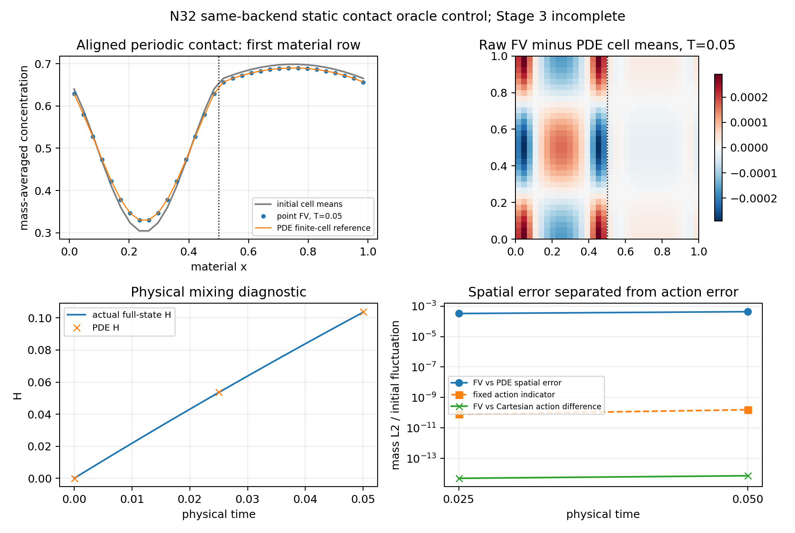

# LTN扩散与掺混：同一普通FV周期接触oracle判别

2026-11-04（Asia/Shanghai）。执行[上轮登记项](../../runs/reconnect-affine-shear-spatial/next-gate-spec.json)。用户本轮明确要求分别提供PDF报告和代码压缩包；只生成下载文件，不发布环境或版本。

**决定：T4_same_backend_static_contact_oracle_control_passed。** 单N32同后端周期接触实现衔接通过；不是三档空间收敛，也不等于T4/三密度完整验收。Stage3 incomplete，fluid ORC关闭，κ未计算。

## 承接与本轮范围

新环境中上轮T3三档结果及约22MB交付包实际可读，SHA核对保持。该轮原N16/32/64共同物质终时误差依次1.35713303171e−3、3.42588344563e−4、8.63454576632e−5，压缩/剪切登记覆盖已补齐，不继续角度或更细格扫描。旧v0.8.0/246未恢复，现代码与原附件分开标注，不将旧对话数字冒作本轮测量。

本轮固定单位周期方形、静止等半两相ρ=1/4、D保留原float.02、T=1/20、N32（1024物质单元）。两接触位于x=.5和周期接缝。一个静态图只构造一次，K16实际及完整独立传播复用该图；无新PDE求解、谱投影拟合或旧候选重跑。研究时间路径仍是指数作用，不冒称原默认隐式Euler的生产CLI迁移已完成。

## 质量平均状态与阻力

状态始终为m_i=∫K_iρdV及c̄_i=m_i⁻¹∫K_iρc dV。本例对齐相内m_i=ρ_i/32²，总质量2.5；c0由原连续初场逐格积分新推导，不插值旧N128平均、不伪称恢复v080数据。所有几何/导通率先封存再读实际m/c0/参考。构造器仅收到点、ID、给定oracle点ρ、D和周期边界，不收到真实物质面、局部F/C或预制g。

普通两半阻力g=面长/[ℓ_i/(ρ_iD)+ℓ_j/(ρ_jD)]。本方格精确相内g=D、4D，界面g=(8/5)D。2048共享正面中低相992、高相992、界面64，逐面几何及独立双中垂线/互反面/面积/固定全点探针核验。未删除跨界面正面，不裁剪、重归一化或修改质量/密度/状态。

## 独立物质参考与半离散控制

复用已封存128模态90位α/β，不重拟合。原连续初场为1/2+f0(x)cos(2πy)，左右f0=(1/5)cos[π(a_px+φ_p)]，(aL,φL)=(16/5,1/5)、(aR,φR)=(4/5,7/5)。完整质量加权透射基为1、cos(2πnx)、sin(2πnx)/ρ，正特征率4π²Dn²。c与ρD∂xc在两接触处连续。

实际参考评价真实有限单元积分，保留sinc因子和法向常数模态的横向衰减。t0直接积分连续公式，不用有限谱截断替换初场。Decimal100/120和独立mpmath80/100核对，固定评价指标沿用64eps√M max(1,max|c0|)，初值float序列化桥4.11469869004e-17原样保留。128模态解析尾项分别按两个正时刻计算，不能把T=.05的尾界套在.025；数值精度控制不是区间认证总误差界。

另一独立控制使用既有Cartesian法向32阶对称环及全部1024离散模态，输入原始c0，保留舍入模态和原始负零特征值，不过滤或置零。独立审计从精确半阻力另建法向环，并用Padé指数核对全部17个全状态端点。实际主路径仍用原点几何和原稀疏指数/完整统一化后端，不从Cartesian先验生成主边权。

## 结果

误差分母固定原初质量波动范数 **0.19751855115977449**。H=1−Var_m(c)/Var_m(c0)沿用原定义。

| t | FV/PDE相对误差 | FV/Cartesian相对差 | 固定作用指标 | 实际H | PDE参考H | 原始质量漂移 |
|---|---:|---:|---:|---:|---:|---:|
| 0 | 0 | 3.15479452882e-15 | 2.1359325619e-12 | 0 | 0 | 0 |
| 0.025 | 0.000329136932855 | 4.85846064433e-15 | 7.88851645114e-11 | 0.0534910955420204 | 0.0536765377901987 | -1.30483731459e-16 |
| 0.05 | 0.000434110789229 | 7.14224526911e-15 | 1.55633002837e-10 | 0.103559525616079 | 0.103898997326895 | -3.30247981739e-16 |

终时FV/PDE误差0.000434110789229与独立半离散空间误差一致，FV/Cartesian差7.14224526911e-15明显更小。此处通过的是同后端实现/独立控制，不因4.34e−4这个单值制造新的物理精度阈值，也不宣称空间收敛已完成。PDE误差分解用独立半离散空间项加原数值/参考/初态正项，不从实际误差中扣除空间误差。



## 测试、审计与失败保留

三项新增检查复核通过，旧490项未重跑，累计记录493项。首次几何夹具N4的L1半径恰为1/4，不满足既有审计严格R<1/4；只改该夹具为N8及相应探针/面数，保留首次源码、日志和JSON，未改审计条件或N32科学算例。其他检查涵盖逐格独立Gauss积分、分时尾项、完整独立序列及Cartesian状态扰坏后的拒绝。

主计算首次2.919秒/65.84MiB。首次完整审计在报告字值比较处失败：原Cartesian总指标为NumPy float64，JSON读回成为Pythonfloat，Python3.12的补偿sum与原NumPy顺序sum产生末位差。保留首次审计源码/日志；追加contact_oracle_reporting.py只恢复原标量类型，数值位不变，同一冻结evaluate精确复现原JSON。48个恢复前文件保持，不改原结果、科学公式、指标或阈值，不重算科学路径。正式重放使用新入口，冻结旧study的--replay不作为交付入口。

第二次完整审计通过，耗时26.508秒/68.51MiB。精确率、最小1e−16 Poisson尾项、原权重和全部独立序列逐位核对；17端点Padé、独立80/100位参考与两个时刻尾项、原始库存/极值/方差/耗散均核验。最大原始质量漂移3.30247981739e-16。

782原文件、15附件、99份先前正式科学清单及上轮交付保持，4份历史诊断既有差异保留。原README/METHOD/CODEX_TASK/PHASE、附件与旧代码/结果/报告不改，仅更新RESEARCH_STATUS。PDF为本轮用户明确授权；无版本、提交推送、环境更改或发布。

## 下一步与完整Stage3差距

下一项只登记同一静止接触N16/32/64空间控制：复用本轮N32路径，只补N16/N64两个静态图、各K16实际/独立路径。保持同一连续初场/物理D/边界/参考系数，固定N16共同物质积分及原生浓度/H并查，两时刻两相邻档改善必须超过预定正项预算；不自动N128、K或模型扫描。本轮未生成这些新空间档材料、图、参考或状态。

之后仍需最终同一后端的移动激波T4及oracle/kernel/ledger三密度来源闭合。当前只用oracle，不能把kernel或ledger改密度后产生的差异当作同一PDE；质量/初场/物理D与边界需固定。没有原始DNS不是阻塞条件，fluid ORC在物理验收前继续关闭，不承诺未经计算的完成日期。

## 下载与重放

[PDF报告](../../exports/LTN_contact_oracle_report_20261104.pdf) · [代码与本轮结果](../../exports/LTN_contact_oracle_code_results_20261104.zip)。压缩包包含全部项目研究代码/文档、782个原始文件、本轮可重放数据及失败记录；不包含全部18GB历史运行目录或21GB历史交付副本，也不冒称恢复缺失v080。旧附件保全在原工作区核验，不重复打包15个附件。

```sh
OPENBLAS_NUM_THREADS=4 OMP_NUM_THREADS=4 PYTHONDONTWRITEBYTECODE=1 \
python research/reconnect/contact_oracle_reporting.py --directory runs/reconnect-contact-oracle --replay
```

代码包CRC/SHA及全新解压重放以exports/LTN_contact_oracle_delivery_20261104.json为准。完整历史保全审计仍需原工作区。
