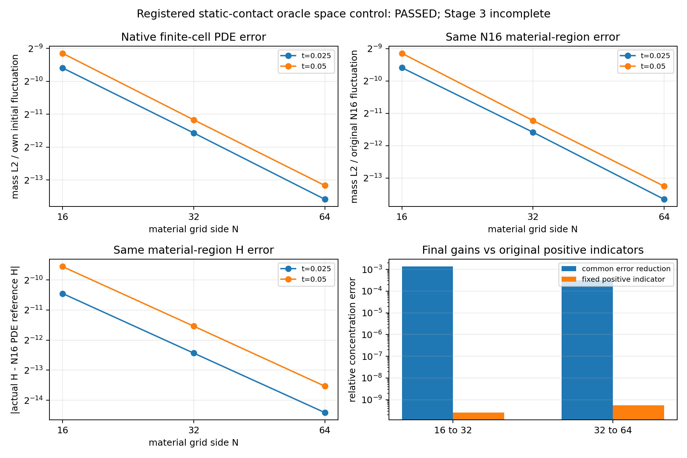

# 同一普通FV周期接触oracle：三档物质空间对照

2026-11-04（Asia/Shanghai）。执行[上轮登记项](../../runs/reconnect-contact-oracle/next-gate-spec.json)，[固定协议](contact_spatial_protocol.json)在新科学输入前锁定。

**决定：T4_three_space_level_static_contact_oracle_control_passed。** 同一静止周期接触N16/32/64，原生/共同浓度及原生/共同H的两次细化改善在两个时刻均超过预定正项指标。这里只完成给定接触oracle基准的三档控制；移动激波与三密度来源尚未闭合，Stage3 incomplete，fluid ORC关闭，κ未算。

## 同一实现与真实物质状态

ρ1/4分相、单位周期方形、原Dfloat.02、T1/20、K16固定。只补N16/N64两个静态点图、两条实际及两条完整独立路径；N32整条路径只加载，不重算。两个新几何及系数全部先封存，再解析质量、c0、参考或旧状态。每档真实m=ρ/N²，c0从同一连续初场逐格质量平均新推导，复用原128模态90位连续投影系数，不插值旧均值或伪称恢复v080。

原periodic_voronoi_fv、普通两半阻力、稀疏指数/完整统一化、K16时序及H公式全部字节不改。低/高相与界面g分别D、4D、(8/5)D，封存后逐面核对；独立重建顶点、双中垂线、互反面、面积和固定全点探针。图构造器不收真实物质面、F/C或参考。没有裁剪、正面删除、状态/质量/密度/行/权重归一化。

各档仍用Decimal100/120位、独立mpmath80/100位有限均值参考，两个正时刻分别核算原128模态尾界，t0直接积分连续公式。已有Cartesian全模态半离散控制、原始负零特征值及全部舍入模态保持，独立Padé核对两新网格各17端点。静态L没有中点冻结误差，不生成虚假的4/8/16时间阶或重复图；K16实际作用误差由完整独立序列和Cartesian控制隔离。

## 固定共同物质观测与误差

共同观测以原派生N16质量为容量，直接加子单元ρc积分后除该容量，不修补初值或参考。原初波动分母固定 **0.19618211932946267**。所有子质量容量因子、初态桥与参考投影桥保留；原生误差另列自身分母，不混同不同网格H或不同区域的误差。

| N | t | 原生误差/自身σ0 | 共同误差/N16σ0 | 原生H | 原生参考H |
|---|---:|---:|---:|---:|---:|
| 16 | 0.025 | 0.00129516265574 | 0.00129516265574 | 0.052787299659527 | 0.0535009682427298 |
| 16 | 0.05 | 0.00176306246144 | 0.00176306246144 | 0.102277155860254 | 0.103603358071504 |
| 32 | 0.025 | 0.000329136932855 | 0.000325373203426 | 0.0534910955420204 | 0.0536765377901987 |
| 32 | 0.05 | 0.000434110789229 | 0.000417790234342 | 0.103559525616079 | 0.103898997326895 |
| 64 | 0.025 | 8.13573562292e-05 | 7.74135290707e-05 | 0.0536712805387306 | 0.0537180962858933 |
| 64 | 0.05 | 0.000108842692317 | 0.000102495677257 | 0.10388581901748 | 0.103971191435279 |

终时共同误差为0.00176306246144、0.000417790234342、0.000102495677257，相邻比4.2199705、4.0761742。这是本例的三档观察，不拟合或认证一般收敛阶，不外推浓度。

## 预定正项预算

两相邻档分别在t=.025/.05要求四种改善都可分辨。浓度预算逐项正加原作用机器/尾项、观测完整序列差、Cartesian独立谱/转换/舍入/时标控制、原评价指标、参考序列化/截断与初态桥；共同观测另乘容量范数因子并加入参考/初态投影桥。H对每档数值项调用原h_indicator，再加直接绝对H参考/初态投影桥。旧N32单例预算继续通过原NumPy类型恢复入口精确复现；新空间比较将具名分量转为原值Pythonfloat后按事先固定sum求和，不修改旧结果或H公式。

| 相邻档 | t | 量 | 改善 | 固定正项指标 | 决定 |
|---|---:|---|---:|---:|---|
| 16→32 | 0.025 | native | 0.000963783576279 | 1.30106782009e-10 | fine_better_resolvably |
| 16→32 | 0.025 | common | 0.000969789452317 | 1.30107531896e-10 | fine_better_resolvably |
| 16→32 | 0.025 | native_H | 0.000528226335024 | 2.07991262257e-09 | fine_better_resolvably |
| 16→32 | 0.025 | common_H | 0.000532700008167 | 2.09720331992e-09 | fine_better_resolvably |
| 16→32 | 0.05 | native | 0.0013259944227 | 2.56630854378e-10 | fine_better_resolvably |
| 16→32 | 0.05 | common | 0.00134527222709 | 2.56631621131e-10 | fine_better_resolvably |
| 16→32 | 0.05 | native_H | 0.000986730500435 | 4.10256800721e-09 | fine_better_resolvably |
| 16→32 | 0.05 | common_H | 0.000989579709353 | 4.13665661301e-09 | fine_better_resolvably |
| 32→64 | 0.025 | native | 0.00024932839747 | 2.83468276123e-10 | fine_better_resolvably |
| 32→64 | 0.025 | common | 0.000247959674355 | 2.83469928703e-10 | fine_better_resolvably |
| 32→64 | 0.025 | native_H | 0.000138626501016 | 4.4966422667e-09 | fine_better_resolvably |
| 32→64 | 0.025 | common_H | 0.000134936108373 | 4.56925193136e-09 | fine_better_resolvably |
| 32→64 | 0.05 | native | 0.000327297791173 | 5.6049988313e-10 | fine_better_resolvably |
| 32→64 | 0.05 | common | 0.000315294557085 | 5.60501552576e-10 | fine_better_resolvably |
| 32→64 | 0.05 | native_H | 0.000254099293016 | 8.89115516745e-09 | fine_better_resolvably |
| 32→64 | 0.05 | common_H | 0.000252040613543 | 9.03475015608e-09 | fine_better_resolvably |



## 检查、审计、保全

三项新增软件检查首次通过：多N界面g/有限单元均值与损坏拒绝；非等子质量直接积分/保留非零桥；四种正项分类、完整序列扰坏及原生高频误差被共同聚合掩盖的拒绝。旧493项未重跑，累计记录496。首次主计算11.662秒/89.62MiB，满足900秒/1024MiB；完整独立审计首次31.944秒/83.16MiB通过。

精确率、最小1e−16 Poisson尾项、原权重及完整独立序列逐位核对，原始库存/极值/方差/耗散保持。共同物质审计不调用生产聚合，直接核验165份快照、825个精确Fraction母单元积分探针；最大fsum差2.22044604925e-16。

782原文件、15附件、100份既有正式科学清单、N32原判别和其失败恢复记录均保持，4份历史诊断既有差异保留。原README/METHOD/CODEX_TASK/PHASE、旧代码/数据/报告不改，只更新RESEARCH_STATUS及备份交接文件。PDF与代码结果ZIP延续用户明确要求；GitHub备份延续已授权范围，不是环境发布或软件版本发布。

## 下一项：移动Becker的物理接口

静止周期接触基准已完成本次三档控制，不继续N128或角度/密度矩阵扫描。下一项只[登记同一移动Becker oracle判别](../../runs/reconnect-contact-spatial/next-gate-spec.json)，先写两个具体接口契约：给定移动外物质端点的x零通量/y周期点Voronoi，以及T显式的时序包装。原周期构造器与指数/统一化实现不改；旧时序helper硬编码T=.05，不能直接冒充T=.1，新增可选包装必须先在T=.05夹具逐位匹配旧路径。

计划δ=.08、D=.02、T=.1、原32物质列，沿单位横向复制8行，点沿固定μ中点轨迹，不强迫成为真实物质格几何中心。只给构图器移动最外端点，不给真实内部物质面；不把激波当壁或把x做周期。复用已保存原32列质量/c0及8192空间/时间参考，不新解PDE，也不把原真物质面FV当作当前点后端已经通过。本轮只绑定这些来源SHA，没有生成新Becker点、图、状态或参考评价。若这一步失败/未分辨，保留并停止，不调代表点或阈值制造通过。

之后仍需同后端完整T4和oracle/kernel/ledger三密度闭合；当前只完成给定静止接触oracle，不据此启用fluid ORC。

## 下载与重放

[PDF报告](../../exports/LTN_contact_spatial_report_20261104.pdf) · [代码与结果ZIP](../../exports/LTN_contact_spatial_code_results_20261104.zip)。ZIP包含研究代码/文档、782原始文件、本轮三档可重放结果及Becker下一步所需的精选保存来源；不含约39GB完整工作区、全部旧运行/导出副本或15原附件。

```sh
OPENBLAS_NUM_THREADS=4 OMP_NUM_THREADS=4 PYTHONDONTWRITEBYTECODE=1 \
python research/reconnect/contact_spatial_study.py --replay runs/reconnect-contact-spatial
```

只重放两条新路径，N32仅加载；不重建几何、解PDE或运行旧候选。逐位重放依赖平台/库构建；完整历史保全审计需原工作区。下载CRC/SHA和新解压重放以交付JSON为准。
